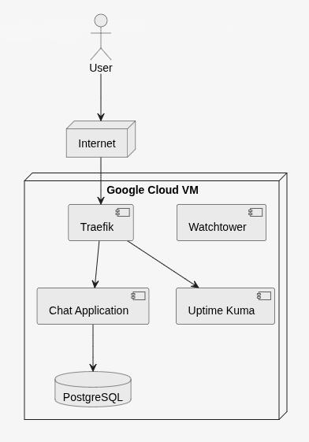
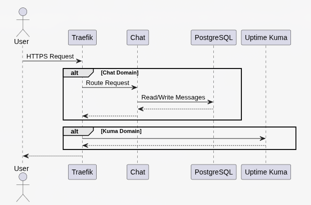
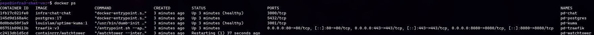
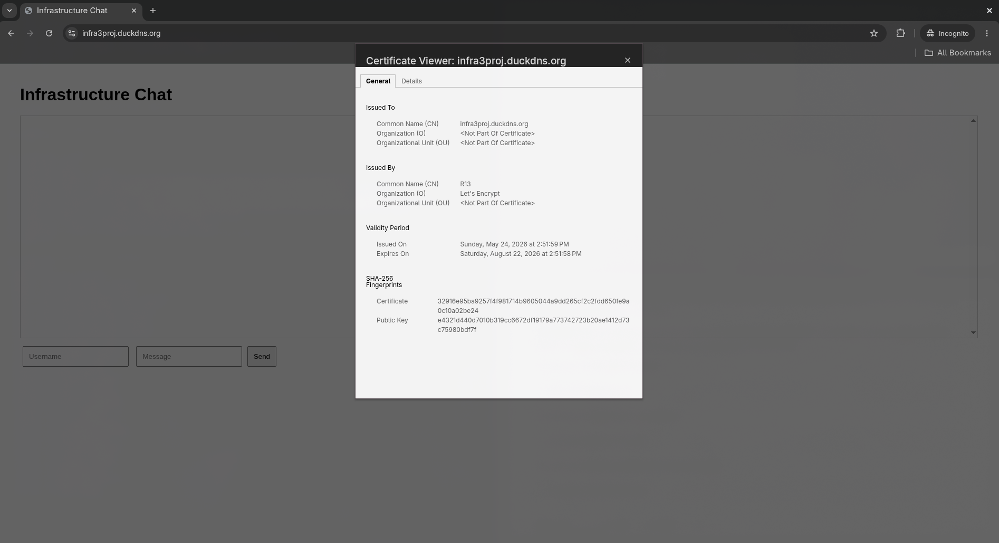

# Infrastructure Project – Container Orchestration

|                         |                                                              |
| ----------------------- | :----------------------------------------------------------- |
| **Student**             | Peter Duga                                                   |
| **Class Group**         | ACS201                                                       |
| **Course**              | Infrastructure 3                                             |
| **Academic Year**       | 2025–2026                                                    |
| **Project**             | Container Orchestration                                      |
| **Deployment Platform** | Google Cloud Platform                                        |
| **Primary Domain**      | infra3proj.duckdns.org                                       |
| **Monitoring Domain**   | infra3proj-kuma.duckdns.org                                  |
| **Repository**          | https://gitlab.com/kdg-ti/infrastructure-3/2025-26/acs201/peter-duga |

## Table of Contents

- [Requirements](#requirements)

- [Project Overview](#project-overview)
- [Architecture](#architecture)
- [PlantUML – High Level Architecture](#plantuml--high-level-architecture)
- [PlantUML – Request Flow](#plantuml--request-flow)
- [Technology Choices](#technology-choices)
- [Container Overview](#container-overview)
- [Persistent Storage](#persistent-storage)
- [Environment Variables](#environment-variables)
- [Local Deployment](#local-deployment)
- [Google Cloud Deployment](#google-cloud-deployment)
- [TLS and Certificates](#tls-and-certificates)
- [Monitoring](#monitoring)
- [Verification](#verification)
- [Conclusion](#conclusion)

## Requirements

Before deploying the project, ensure the following tools are available:

| Component                   | Purpose                        |
| --------------------------- | ------------------------------ |
| Docker Engine               | Container runtime              |
| Docker Compose              | Service orchestration          |
| Google Cloud SDK (`gcloud`) | VM provisioning and management |
| SSH                         | Remote administration          |
| `dig`                       | DNS verification               |
| Git                         | Source control and deployment  |
| DuckDNS account             | Dynamic DNS                    |
| Google Cloud account        | VM hosting                     |

---

# Project Overview

This project implements a small real-time chat application deployed using Docker Compose. The solution focuses on infrastructure automation, container orchestration, HTTPS termination, monitoring, persistence, and cloud deployment rather than application complexity.

The application consists of a Node.js chat service backed by PostgreSQL. Requests are routed through Traefik, which acts as a reverse proxy and automatically obtains TLS certificates from Let's Encrypt using ACME. Uptime Kuma is included as a monitoring solution and allows availability checks of the deployed services.

The project can be executed locally using Docker Compose and can also be deployed to a Google Cloud virtual machine using the provided automation scripts.

---

# Architecture

The architecture consists of four primary services. Traefik is the public entry point and routes incoming requests based on the requested hostname. The chat application stores all messages in PostgreSQL, while Uptime Kuma provides service monitoring.

## PlantUML – High Level Architecture



## PlantUML – Request Flow




## Running Containers




## Valid HTTPS Certificate



---

# Technology Choices

Traefik was selected instead of Nginx because it integrates directly with Docker and can automatically discover containers through labels. It also includes built-in ACME support, removing the need for a separate Certbot installation.

PostgreSQL was chosen as the database because the assignment requires a dedicated SQL or in-memory database running in a separate container. Persistent volumes are used to ensure that application and database data survive container recreation.

DuckDNS provides public DNS records for the Google Cloud VM, while Let's Encrypt issues trusted TLS certificates. Uptime Kuma was included as an example of an existing third-party containerized application and provides basic monitoring capabilities.

---

# Container Overview

| Container     | Purpose                           |
| ------------- | --------------------------------- |
| pd-traefik    | Reverse proxy and TLS termination |
| pd-chat       | Node.js chat application          |
| pd-postgres   | PostgreSQL database               |
| pd-kuma       | Monitoring service                |
| pd-watchtower | Automatic container updates       |

---

# Persistent Storage

Docker volumes are used to persist data independently of the containers.

| Volume           | Purpose          |
| ---------------- | ---------------- |
| pd-chat-data     | Application data |
| pd-postgres-data | PostgreSQL data  |
| pd-kuma-data     | Uptime Kuma data |

---

# Environment Variables

Configuration is externalized using a `.env` file.

Example:

```env
CHAT_DOMAIN=infra3proj.duckdns.org
KUMA_DOMAIN=infra3proj-kuma.duckdns.org

EMAIL=example@example.com

DB_HOST=postgres
DB_PORT=5432
DB_NAME=chatdb
DB_USER=chatuser
DB_PASSWORD=secret
```

This approach allows the same container images to be used in different environments without modification.

---

# Local Deployment

Clone the repository and enter the project directory.

```bash
git clone git@gitlab.com:kdg-ti/infrastructure-3/2025-26/acs201/peter-duga.git
cd infra-chat
```

Start the stack:

```bash
docker compose up -d --build
```

Verify that all services are running:

```bash
docker compose ps
```

The chat application becomes available through Traefik and can also be reached directly on the container network.

To stop the environment:

```bash
docker compose down
```

---

# Google Cloud Deployment

The repository contains a set of automation scripts used to provision, configure, deploy, and manage the application on Google Cloud Platform.

| Script              | Purpose                                                      |
| ------------------- | ------------------------------------------------------------ |
| `create-vm.sh`      | Creates the Google Cloud virtual machine.                    |
| `setup-vm.sh`       | Installs Docker, Docker Compose, and all required dependencies on the VM. |
| `deploy.sh`         | Main deployment script that orchestrates the complete deployment process. |
| `deploy-git.sh`     | Deploys the application by cloning or updating the Git repository on the VM. |
| `deploy-scp.sh`     | Deploys the application by copying the local project files to the VM using SCP. |
| `update-duckdns.sh` | Updates the DuckDNS records with the current VM public IP address. |
| `wait-for-dns.sh`   | Waits until the DNS records have propagated correctly.       |
| `ssh-vm.sh`         | Opens an SSH connection to the VM.                           |
| `get-vm-ip.sh`      | Retrieves the public IP address of the VM.                   |
| `delete-vm.sh`      | Removes the virtual machine and associated resources.        |
| `reset-duckdns.sh`  | Resets the configured DuckDNS records if required.           |

Deployment is performed from the root directory of the project using the main deployment script. The deployment method must be specified as either `git` or `scp` with `scp` being set as default.

Deploy using Git:

```bash
./scripts/deploy.sh git
```

Deploy using SCP:

```bash
./scripts/deploy.sh scp
```

The `git` option deploys the application by cloning or updating the Git repository directly on the virtual machine. The `scp` option deploys the current local project state by securely copying the project files to the VM before starting the containers.

The deployment script automatically creates or updates the application on the VM, updates DNS records, waits for DNS propagation, and starts the production environment.

To connect to the VM manually:

```bash
./scripts/ssh-vm.sh
```

To retrieve the VM public IP address:

```bash
./scripts/get-vm-ip.sh
```

To remove the deployment and delete the VM:

```bash
./scripts/delete-vm.sh
```

---

# TLS and Certificates

HTTPS is terminated by Traefik. Certificates are automatically requested from Let's Encrypt using the ACME protocol and stored inside the `letsencrypt/acme.json` file.

The production deployment exposes ports 80 and 443. Incoming HTTP requests are used for ACME validation, while HTTPS provides encrypted communication for users.

The HTTPS certificate may take some time to be issued due to the necessity of DNS records propagation. If the DNS records are not propagated yet the certificate cannot be issued until the propagation is complete. Traefik will issue a default certificate in the meanwhile and keep retrying to get the certificate from Let's Encrypt until it succeeds.

---

# Monitoring

Uptime Kuma is deployed as a separate container and exposed through Traefik. It can be used to monitor service availability and validate that the chat application remains operational after deployment.

---

# Verification

After deployment, the following checks can be used to verify correct operation:

```bash
docker compose ps
```

```bash
docker logs pd-traefik
```

```bash
docker logs pd-chat
```

```bash
dig infra3proj.duckdns.org
```

```bash
curl https://infra3proj.duckdns.org
```

A successful deployment should provide:

- Running containers
- Valid TLS certificates issued by Let's Encrypt
- Accessible chat application
- Reachable monitoring dashboard
- Persistent PostgreSQL storage

---

# Assignment Requirements Mapping

| Requirement | Implementation |
|------------|------------|
| Docker Compose orchestration | docker-compose.yml and docker-compose.prod.yml |
| SQL database in separate container | PostgreSQL (`pd-postgres`) |
| Reverse proxy in separate container | Traefik (`pd-traefik`) |
| Existing third-party application | Uptime Kuma (`pd-kuma`) |
| HTTPS with valid certificate | Let's Encrypt via Traefik ACME |
| Routing to multiple services | Chat and Uptime Kuma |
| Persistent storage | Docker volumes |
| Environment variables | `.env` configuration |
| Local deployment | Docker Compose |
| Cloud deployment | Google Cloud VM |

---

# Conclusion

The project demonstrates container orchestration using Docker Compose, automated cloud deployment on Google Cloud, reverse proxying with Traefik, automatic TLS certificate management through Let's Encrypt, persistent PostgreSQL storage, monitoring with Uptime Kuma, and infrastructure automation through deployment scripts. The solution can be executed both locally and in a cloud environment while maintaining the same architecture and configuration approach.
